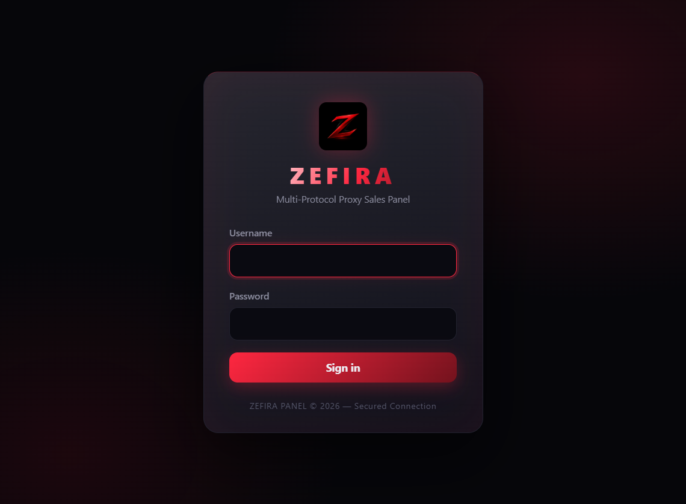
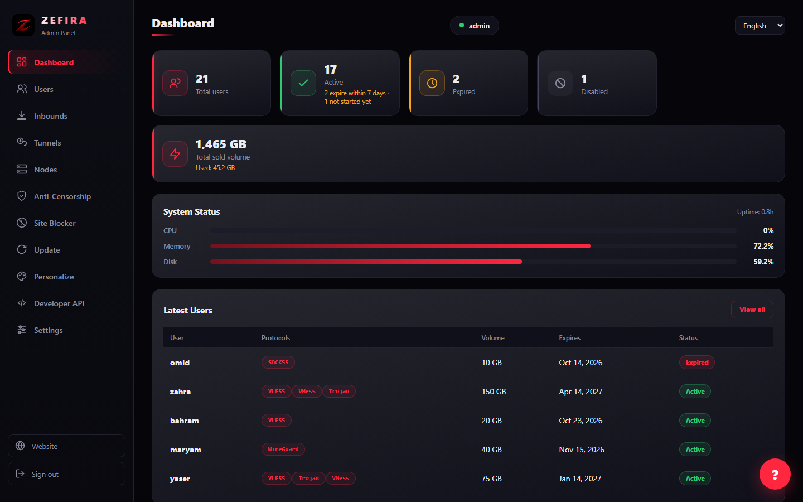
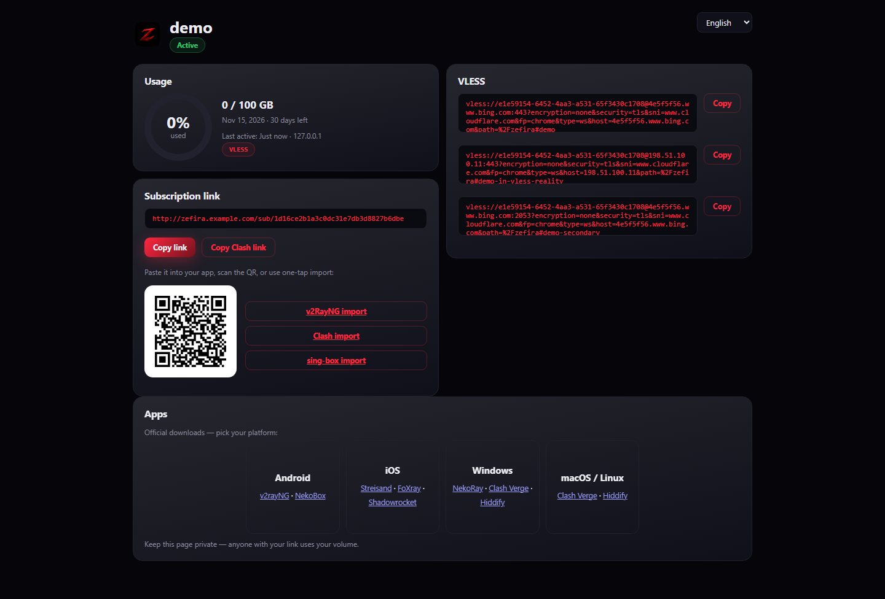
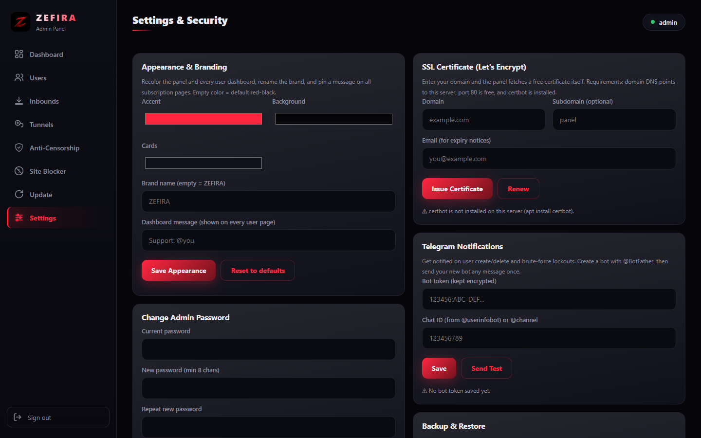

# Zefira

[](LICENSE)
[](https://mrlurix.github.io/zefira-panel/)
[](https://github.com/mrlurix/zefira-panel/blob/main/attack_test.py)

> 🌐 **Languages:** **English** · [فارسی](README.fa.md) · [中文](README.zh.md) · [Русский](README.ru.md)

> 📚 **Documentation: [mrlurix.github.io/zefira-panel](https://mrlurix.github.io/zefira-panel/)** — install guide, user manual, API reference, FAQ.

Simple panel for managing and selling VPN accounts. Started as a private tool for my own servers and cleaned up for public use.

Works with VLESS, VLESS-REALITY, VMess, Trojan, Shadowsocks, Hysteria2, WireGuard, OpenVPN, L2TP/IPsec, Cisco AnyConnect and SOCKS5. One user can have multiple protocols at once and gets a single subscription link.

Built with FastAPI + SQLite by default - no Docker required, just Python.
SQLite is the default because a single-VPS panel does not need anything more.
Set `DATABASE_URL` and PostgreSQL or MySQL are used through the same code path.

### Screenshots






### Install on a server

One-liner:

```bash
curl -fsSL https://raw.githubusercontent.com/mrlurix/zefira-panel/main/install.sh | sudo bash
```

Prefer to read it first? Download, look, then run that exact copy:

```bash
d="$(mktemp -d)"                       # a private dir only you can read
curl -fsSL -o "$d/install.sh" \
  https://raw.githubusercontent.com/mrlurix/zefira-panel/v1.15.47/install.sh
less "$d/install.sh"
sudo bash "$d/install.sh"
rm -rf "$d"
```

> Both work. The one-liner pipes whatever upstream serves at that second
> straight into a root shell, so if you care which code runs as root, use the
> second form: it lands in a directory `mktemp` just created for you (a fixed
> `/tmp/zefira-inst` could be pre-created by another local user, and `mkdir -p`
> succeeds silently on a directory it does not own), and the `v1.15.47` tag pins
> the installer itself.
>
> The installer then clones the panel source at the release tag it ships with.
> Pin it harder if you want to name the exact commit:
>
> ```bash
> ZEFIRA_EXPECTED_SHA=<40-char commit> sudo bash install.sh
> ```
>
> Refused unless the clone is that commit. `ZEFIRA_INSTALL_REF=main` restores
> the older "track the branch" behaviour. The installer also refuses to use
> `/opt/zefira` itself as its source: that tree is writable by the service
> account, so trusting it would hand a service foothold root.

The script installs Python deps, creates a systemd service and stores your
first-run credentials in `instance/first-run-credentials.txt` (mode 600) -
`sudo cat` it, then delete it after the first login. Works on Ubuntu / Debian /
Alma / Rocky (needs Python 3.10+).

With the nginx option enabled the panel binds `127.0.0.1` only and the firewall
opens just 80/443; without it the panel answers plain HTTP on the chosen port,
so put TLS in front of it before you use real accounts.

To remove later: `sudo bash install.sh --uninstall`

### Manual install

```bash
git clone https://github.com/mrlurix/zefira-panel.git
cd zefira-panel
python3 -m venv .venv
source .venv/bin/activate
pip install -r requirements.txt
python -m uvicorn main:app --host 127.0.0.1 --port 8000 --no-server-header --no-proxy-headers
```

Bind `127.0.0.1` and put a TLS reverse proxy in front of it. `--host 0.0.0.0`
publishes the admin login in clear text (no Secure cookies, no HSTS).

First run writes the admin username/password to
`instance/first-run-credentials.txt` (mode 600) and prints only the path. If
you set `ZEFIRA_ADMIN_PASSWORD` before starting, it will use that instead.

> **Run exactly one worker.** Rate limiters, the restore/update locks, the node monitor loop and the settings cache live in process memory - `--workers N` multiplies rate-limit budgets and can interleave restores. Scale with more machines, not more workers.
>
> This is enforced, not just advised: the panel reads `WEB_CONCURRENCY` at startup and **refuses to start** above one worker, naming what breaks. If you have genuinely moved that state into shared storage, `ZEFIRA_ALLOW_MULTI_WORKER=1` acknowledges it - and logs a warning that the panel is unprotected if the limiters are not shared.
Default login: `http://YOUR_SERVER_IP:8000`

### What you get

- Users with traffic limit, expiry date, and notes. Start-on-first-use is supported if you want the timer to start only after the first connection. Pencil button per row edits note, volume, expiry, device limit.
- Multiple protocols per user, all in one subscription. Supports normal base64 subs and Clash YAML (`?format=clash`). Link remarks show the plain username.
- The subscription feed carries **share links and nothing else**. `WireGuard`, `OpenVPN`, `L2TP/IPsec` and `Cisco AnyConnect` are file protocols - a `.conf`/`.ovpn` is not a URI, so no link importer can read one - and they are delivered as files: the dashboard card, the per-user **Download config** button, or the ZIP. A plan made *only* of file protocols therefore has no links to list, and the feed answers `422` with that reason instead of a page of text a client cannot parse. Before v1.15.8 it inlined those files under a `### OpenVPN ###` header; a client skips that one `#` line and is handed the other ~90 as if they were nodes.
- Browser dashboard: opening a subscription link in a browser shows usage, links, QR and apps; VPN clients always get raw bytes.
- Inbounds: define extra ports/hosts per protocol and every user gets links for all of them. Pin inbounds to server nodes — offline nodes are auto-excluded from links.
- Server nodes: register remote servers with 5-minute health checks, latency and uptime; on-demand check, enable/disable, safe delete.
- Anti-censorship: generate REALITY keys inside the panel, links use `xtls-rprx-vision` and rotate SNI automatically.
- BackPack tunnel nodes: create tunnels for your Iran/Kharej servers, download the setup guide with the token already filled in, and check if the Iran side is reachable. The panel is pinned to BackPack **v1.8.5** and exposes its newer options as real fields: a per-tunnel **traffic cap**, a **restart schedule** for both ends, **backup addresses** that fail over when the Iran host stops answering, and a **performance preset** (`turbo` / `aggressive` / `conservative` / `custom`). Each tunnel also carries its own **SNI** for the spoofing carrier.
- QR codes for every subscription, ZIP download for configs.
- AI assistant bubble: panel-only helper (Groq-first, OpenAI/Anthropic/Gemini/Ollama) for beginners.
- One-click updates from GitHub with changelog preview, right inside the panel.
- **Developer API**: scoped tokens (`zfp_…` bearer) for Telegram bots and dashboards — no CSRF header needed. Scopes: `full`, or least-privilege `bot` (list/create users only). The in-panel Developer API section lists your tokens, creates one and shows a ready-to-run example.
- Full personalization: theme colors, brand name, dashboard message — plus a **menu layout** you can reorder and trim (Dashboard, Users, Inbounds, Personalize and Settings always stay), and per-card show/hide on the customer dashboard itself.
- Strong password gate on sensitive actions, full audit log, system stats, Telegram notifications if you want.
- JSON backup / restore (both password confirmed), optional encrypted backups. Also imports/exports all settings.
- Runs as an unprivileged `zefira` systemd user (never root); volume quota enforced on subscriptions.

Full guides live on the docs site (link at the top).

### Settings you might want to change

Most things are in the panel itself: **Settings -> Server / Hosts Settings** (domain, ports, DNS, REALITY settings) and **Settings -> Remote Access** (public URL, trusted proxies).

If you prefer env files, copy `.env.example` to `.env`. Env vars are only used as defaults on first start.

### Security

I tried to keep it tight: scrypt for passwords, JWT in HttpOnly cookies, rate limits on login (per source IP, checked before any hashing), CSRF checks, strict CSP, parameterized queries, no innerHTML for user data, and audit logging.

**What is encrypted:** the Telegram/AI credentials, the REALITY private key,
tunnel tokens, the per-customer VPN credentials in the database
(`secret_data` — the WireGuard private key, OpenVPN client keypair, L2TP PSK and
per-protocol passwords, encrypted since v1.15.27), the customer subscription
tokens (since v1.15.29), and encrypted backups. All of it is AES/Fernet under
`instance/secret.key`.

The subscription token needed care: it has to stay an indexed lookup for
`/sub/{token}`, so the column holds a Fernet blob and a separate HMAC digest
column provides the index. Before that, a token lifted straight out of
`instance/zefira.db` answered `/sub/{token}` with 200 and the customer's
private key, and an unencrypted backup carried it in cleartext.

**What is not encrypted:** display names, notes, usage counters and timestamps —
billing data, not credentials. Treat the database and unencrypted backups as
customer credential material anyway: keep `instance/` at `700`, use encrypted
backups or full-disk encryption, and see [SECURITY.md](SECURITY.md).

The panel also accepts `DATABASE_URL`, so PostgreSQL and MySQL work through the
same code path if you need concurrent writers.

### Running the tests

There are 54 test suites. 16 hit the running panel from the outside and
38 are static guards that need nothing running. One command runs all 54:

```bash
python run_all_tests.py http://127.0.0.1:8000 admin YOURPASS
```

Or run them one at a time, restarting the panel between suites:

```bash
python feature_test.py        http://127.0.0.1:8000 admin YOURPASS   # feature coverage
python security_test.py       http://127.0.0.1:8000 admin YOURPASS   # security / abuse
python functional_test.py     http://127.0.0.1:8000 admin YOURPASS   # functional flows
python attack_test.py         http://127.0.0.1:8000 admin YOURPASS   # live attack probes
python attack_quota_test.py   http://127.0.0.1:8000 admin YOURPASS   # quota / schema boundaries
python attack_paths_test.py   http://127.0.0.1:8000 admin YOURPASS   # operator paths / restore
python frontend_bugs_test.py  http://127.0.0.1:8000 admin YOURPASS   # front-end regressions
python panel_sections_test.py http://127.0.0.1:8000 admin YOURPASS   # panel sections end-to-end
python settings_cards_test.py http://127.0.0.1:8000 admin YOURPASS   # every settings card end-to-end
python security_audit_test.py http://127.0.0.1:8000 admin YOURPASS   # security audit round 1
python mcp_routes_test.py      http://127.0.0.1:8000 admin YOURPASS   # the MCP panel routes, end to end
python mcp_conformance_test.py http://127.0.0.1:8000 admin YOURPASS   # MCP conformance, real SDK, both transports
```

These need no running panel - they are static
guards over the installer, the docs and the release notes:
```bash
python installer_test.py                                   # installer CLI
python dashboard_link_test.py                              # customer dashboard link
python proxy_trust_test.py                                 # proxy trust + client IP
python link_encoding_test.py                               # share-link remark encoding
python update_guard_test.py                                # updater intrusion guard
python migration_guard_test.py                              # schema migration steps
python env_symlink_guard_test.py                              # installer env symlink
python bump_assets_guard_test.py                              # docs asset bump inputs
python installer_unit_test.py                              # installer heredoc safety
python secret_at_rest_test.py                              # customer secrets encrypted at rest
python security_hardening_test.py                              # audit hardening: secret disclosure budgets, fail-closed scopes
python subscription_token_test.py                              # the subscription bearer token is not readable at rest
python installer_guard_test.py                              # installer symlink + banner guards
python readme_i18n_test.py                                 # README translations
python telegram_hint_test.py                               # telegram error hints
python api_scope_test.py                                   # API token scope control
python settings_guard_test.py                              # settings + download guards
python restore_guard_test.py                               # restore + snapshot + token cap guards
python harness_login_test.py                               # harness can reach its admin
python release_notes_test.py                               # assistant not stale
python settings_groups_test.py                              # settings grouped, nothing lost
python i18n_test.py                                        # docs i18n dictionaries
python docs_coverage_test.py                               # docs cover the panel
python i18n_dict_check.js                                  # docs i18n coverage
python i18n_render_check.js                                # docs i18n renderer safety
python mcp_tools_test.py                                 # the MCP tool table
python mcp_exec_test.py                                  # MCP call building and the HTTP executor
python mcp_asgi_exec_test.py                             # the in-panel MCP executor
python mcp_protocol_test.py                              # MCP JSON-RPC dispatch
python mcp_stdio_test.py                                 # the MCP stdio transport
python mcp_guards_test.py                                # MCP bug-hunt regression guards
```

`feature_test.py` walks the panel's 67 API routes across its 11 sections and
asserts each capability is actually usable (real links in a subscription, a
decodable QR, a working config archive, the bot-scope matrix, backup/restore
round-trips…), not merely reachable. `attack_test.py` fires the hostile
traffic itself: header spoofing, stored XSS, path traversal, oversized/over-
nested bodies, unicode/encoding tricks, timing oracles, login floods, limiter
eviction attempts, the full auth matrix. `attack_quota_test.py` covers the
accounting paths a customer actually hits: quota/expiry gating per client type,
start-on-first-use, device limits, and every Pydantic boundary on create and
patch. `attack_paths_test.py` walks the operator paths the other suites skip:
templates (create-from-template, upsert), inbounds + node pinning, CSV export,
blocked sites, the Clash YAML invariants, theme/appearance, audit/stats/system,
the BackPack tunnel lifecycle, and a full backup/restore round-trip.
`frontend_bugs_test.py` covers what HTTP tests structurally cannot see — the
panel and docs front-end logic (a warning that can never be shown, a copy
button that copies its own label, a list re-rendered from a stale response, a
stale asset version in a `fetch()` URL). All nine restore the panel to its
shipped defaults afterwards, so the suites are
order-independent and can run against a live panel (or all of them in one go with
`python run_all_tests.py admin YOURPASS`). A green run ends with
`N/N suites passed` - ten live suites plus the rest that need no server. The
per-suite counts are deliberately **not** written down here: they move every
time a check is added, and a copied number that has drifted is worse than no
number, because it reads as something to compare against. Read them off the run
itself, which prints `N/N checks passed` per suite.

Three more harnesses need no running panel and `run_all_tests.py` runs them
too. Each one executes shipped code rather than reading it, because every
defect below passed a source-level review:

```bash
python installer_test.py      # the installer's guarantees, as static guards
node i18n_dict_check.js       # the docs dictionaries, loaded and inspected
node i18n_render_check.js
python audit_retention_test.py                       # audit retention figure matches the code
python type_hints_test.py                              # type annotations do not regress
python api_response_shapes_test.py                  # API reference matches reality (live)     # the docs renderer, fed hostile strings
```

Nine more do not need a server either, and all nine were written because the
defect they cover had already shipped:

```bash
python dashboard_link_test.py    # the customer dashboard link, in a guessed-domain install
python proxy_trust_test.py      # proxy trust and client IP agreement
python link_encoding_test.py    # share-link remark encoding
python update_guard_test.py     # the updater's runtime-intrusion guard
python migration_guard_test.py  # schema migration steps, one transaction each
python env_symlink_guard_test.py # the installer writing .env through a symlink
python bump_assets_guard_test.py# docs asset-bump inputs
python i18n_test.py             # panel templates and JS against every locale
python docs_coverage_test.py    # every endpoint, sidebar section and setting documented
```

`i18n_dict_check.js` exists because the docs are four languages that must stay
in step, and nothing was checking that. It loads `docs/assets/i18n.js`, reads
the object a browser would get, and fails on a key that is missing or empty in
any language, a value that holds two entries run together, mojibake, a
`data-i18n` attribute misspelled as something `applyI18n` does not read, and a
page referencing a key that exists in no language. It reports - but does not
fail on - a value identical to the English, because that is sometimes correct:
`GitHub Security Advisories` is GitHub's own feature name, and translating a
protocol list would make it worse. Its first version demanded a difference
from English and flagged both.

After editing anything under `docs/`, run `python docs/build_index.py`. It
rebuilds the search index, gives every heading a stable anchor, and bumps the
asset cache-bust **itself** via `docs/bump_assets.py`. That last part is not
cosmetic: the counter lives in fourteen places, and raising it only on the
twelve pages leaves `docs.js` and `support-ai.js` fetching the previous
`search-index.json` and `site-knowledge.json` - fresh HTML, stale search
results, and a support bot answering from last week's knowledge base.

### Dependencies

`requirements.txt` holds the human-maintained **direct** pins (what to upgrade
on purpose). `requirements.lock` is the fully resolved, **hash-locked** set that
`install.sh` and the in-panel updater actually install:

```bash
pip install --require-hashes --no-deps -r requirements.lock
```

Exact top-level pins never pinned the transitive graph - `uvicorn[standard]`
alone drags in a dozen version ranges - so two installs of the same
`requirements.txt` could execute different code. Regenerate the lock after
editing `requirements.txt`, then verify it:

```bash
python tools_lock.py
python verify_lock_hashes.py
python operability_test.py                                 # single-worker refusal, request correlation, annotation coverage
python api_coverage_test.py                                # API reference covers every route
python update_status_latency_test.py                # the update page never waits on GitHub
python backpack_tunnel_test.py             # BackPack v1.8.5 tunnel capabilities
python ai_url_guard_test.py               # the AI fetch URL matches its validated base
python reliability_guards_test.py   # the defects an agent sweep found stay fixed
python migration_run_test.py       # the migration list, executed
python security_doc_test.py              # the security policy states no coverage figure
```

> **Always run the verifier.** The lock is generated on one machine but
> installed on another, and a hash that only covers the generating machine's
> platform aborts the install on the server — or, worse, leaves a lock that
> verifies nothing. An earlier version of `tools_lock.py` recorded only the
> artifacts it could download locally, which left 11 of 31 packages
> uninstallable on Linux. `verify_lock_hashes.py` checks every recorded hash
> against PyPI and reports any entry whose coverage a Linux install needs is
> missing. It needs network access; `tools_lock.py` also prints the command.

### API

It's a normal REST API, all under `/api/*`. Check the Docs page in the panel for the full table, or just open browser devtools while using the panel.

### License

MIT - see [LICENSE](LICENSE). Do what you want, just keep the notice.

### Donation

If Zefira helps you, consider supporting it: wallet addresses on the [donate page](https://mrlurix.github.io/zefira-panel/donate.html).

```text
TRX BEP-20:    0x4caF4EfDe83784351ED81e39f56e5dB49FE8FE18
ETH BEP-20:    0x4caF4EfDe83784351ED81e39f56e5dB49FE8FE18
USDC BEP-20:   0x4caF4EfDe83784351ED81e39f56e5dB49FE8FE18
```

---

If you like it, give it a star. Issues and PRs are welcome.

**English** · [فارسی](README.fa.md) · [中文](README.zh.md) · [Русский](README.ru.md)
